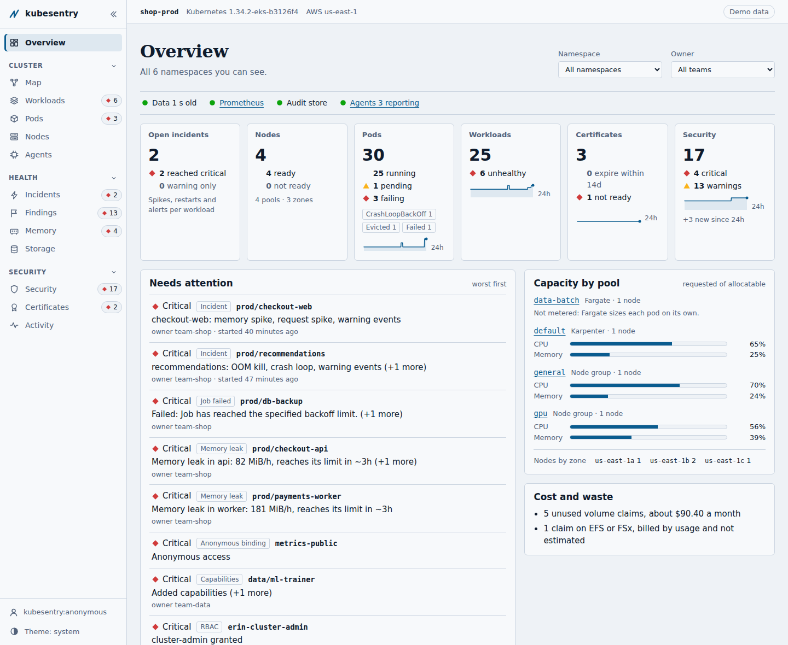
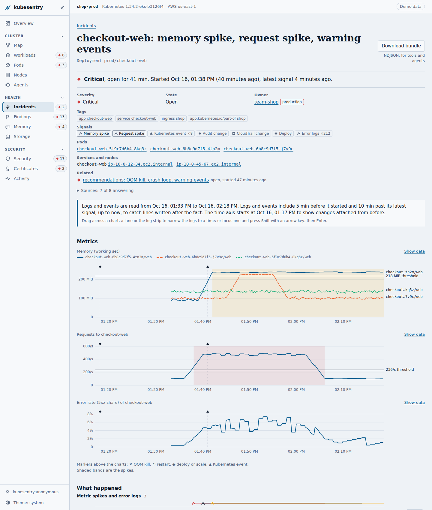
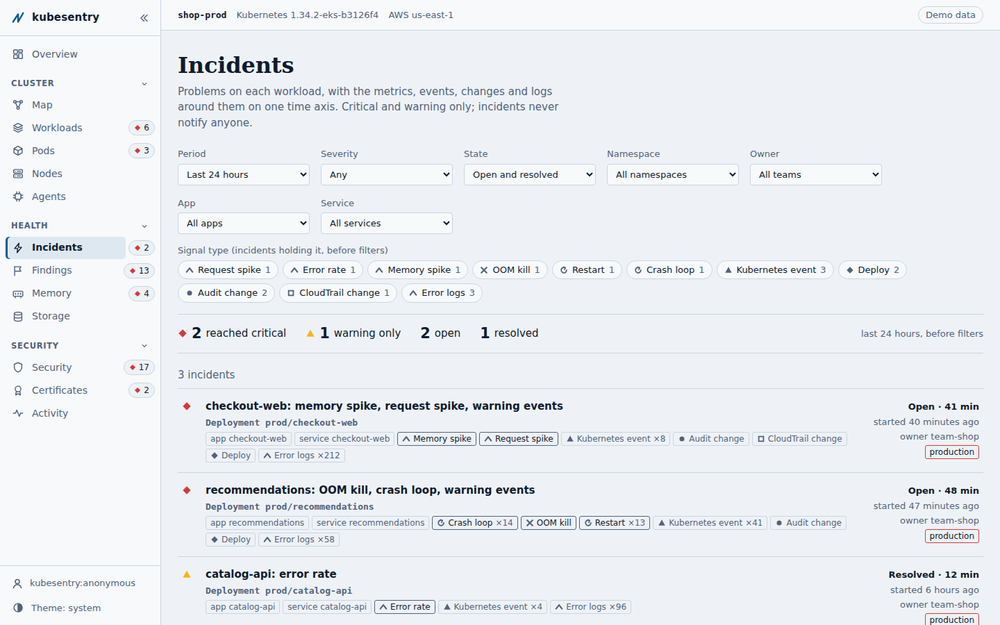
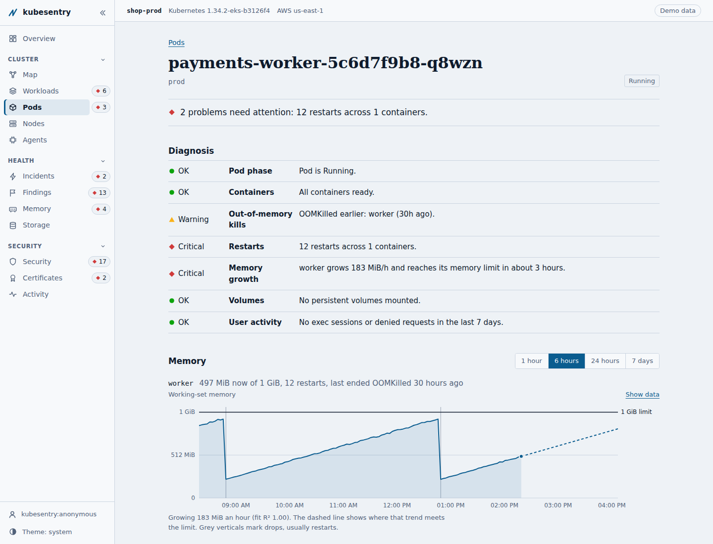
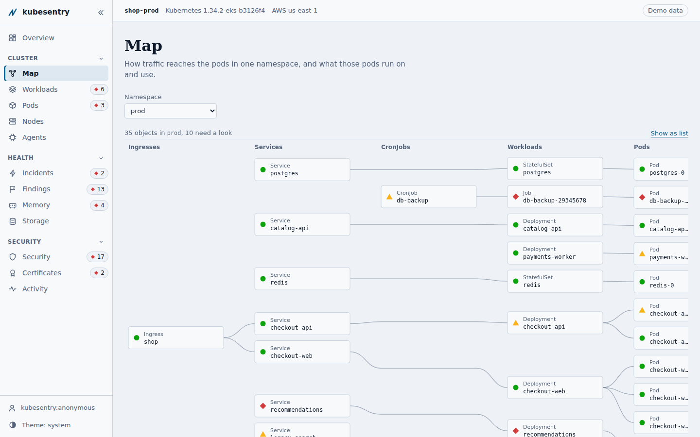
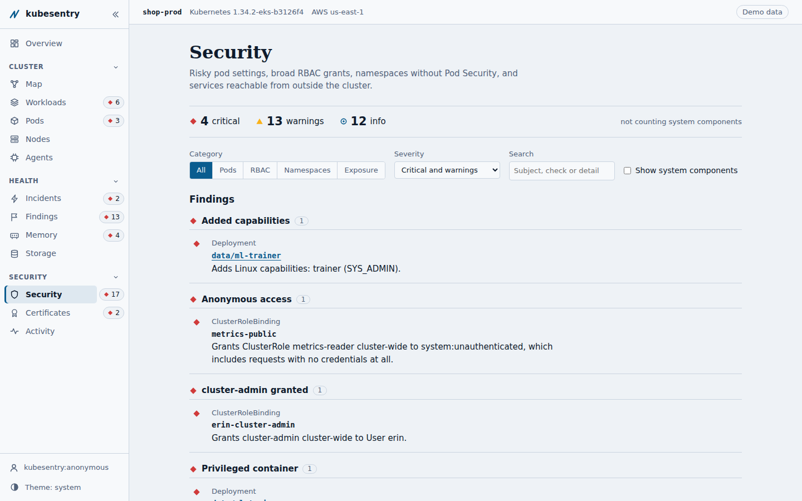
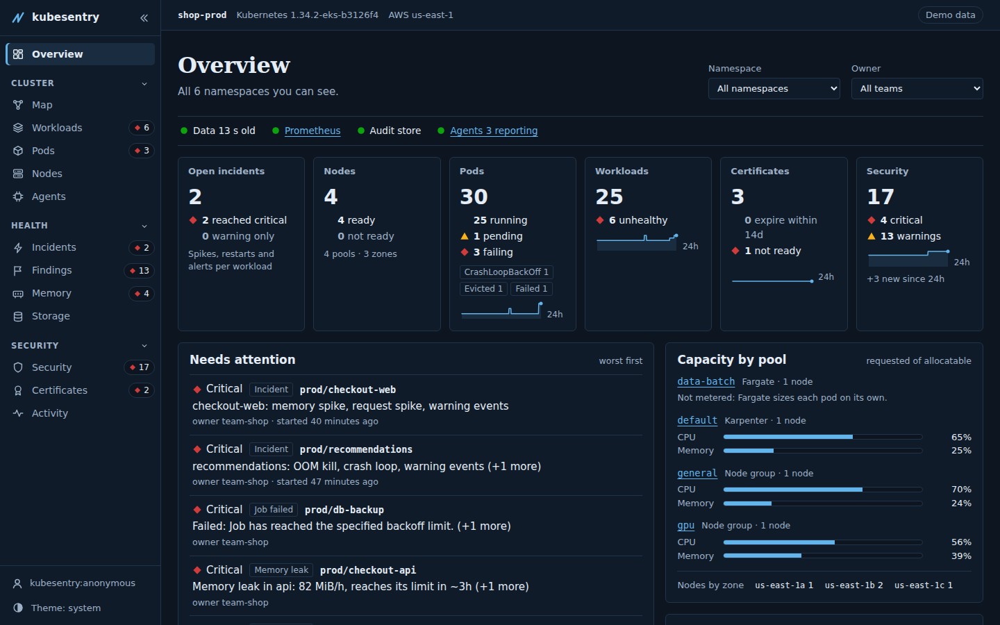

# kubesentry

A self-hosted Kubernetes observability and debugging dashboard for what cluster browsers don't show:
- **incidents** that line up metrics, events, logs and changes on one timeline;
- **memory leaks** before they become OOM kills;
- **who did what**, from the API audit log;
- **unused volumes** and their cost;
- **security posture**.

Each user sees only what their Kubernetes RBAC allows.



## What it does

| | |
|---|---|
| **Overview** | Cluster health at a glance: nodes, pods, workloads, certificates and security, with the worst problems first, capacity by node pool, sensitive activity and storage cost. Filter by namespace or owning team. |
| **Incidents** | One timeline per app: request and memory spikes, restarts and OOM kills, Kubernetes events, deploys, audit and CloudTrail changes, and logs (CloudWatch or `kubectl logs`), all on one time axis. Each incident covers at most 24h and downloads as a redacted, agent-ready bundle. |
| **Memory** | OOM kills and leak detection with a predicted time to the limit (Prometheus or Amazon Managed Prometheus). |
| **Activity** | Kubernetes API audit events (webhook, log file or EKS CloudWatch Logs), stored in memory or Postgres. |
| **Map, workloads, nodes** | App topology from ownerReferences and EndpointSlices; nodes grouped by pool and zone. |
| **Security, certificates** | Pod security, RBAC, exposure and Pod Security labels; cert-manager expiry and failing issuers. |
| **Storage** | Unused PVCs with an estimated monthly cost; EBS-aware, with EFS/FSx shown as "billed by usage". |
| **Processes** | Per-pod processes from an optional node agent. |
| **Alerts** | Findings sent to Alertmanager (or the AMP alert manager), routed by owning team, with an Alerts page to acknowledge and silence them. Opt-in. |

**Built for enterprise clusters:**
- SSO through oauth2-proxy, with per-user scope by SubjectAccessReview.
- An informer cache, tested at 500 nodes and 10,000 pods.
- Postgres for HA.
- A Helm chart, signed multi-arch images, and native binaries.

## Screenshots

| Incident timeline | Incidents |
|---|---|
|  |  |
| **Memory leak on a pod** | **App map** |
|  |  |
| **Security** | **Dark mode** |
|  |  |

## Quick start

**Try it with no cluster.** This uses synthetic data, including three incidents:
```bash
go run ./cmd/demo                       # http://127.0.0.1:8080
```

**From your laptop against a cluster** (remote mode). Nothing is installed in the cluster, and kubesentry uses your kubeconfig identity:
```bash
aws eks update-kubeconfig --name prod-eks --region us-east-1 --alias prod-eks
kubesentry -kube-context prod-eks -auth-mode none   # http://127.0.0.1:8080
```
Binaries for macOS, Linux and Windows are on the [releases page](https://github.com/ByronGary/kubesentry/releases).

**In the cluster** (Helm):
```bash
helm upgrade --install kubesentry oci://ghcr.io/byrongary/charts/kubesentry -n kubesentry --create-namespace
```

## Documentation

| Topic | Guide |
|---|---|
| Deploying on EKS (IAM, SSO, Postgres, sizing) | [docs/deploy-eks.md](docs/deploy-eks.md) |
| Running from a laptop (remote mode) | [docs/run-remote.md](docs/run-remote.md) |
| Incidents | [docs/incidents.md](docs/incidents.md) |
| Alerts and runbooks | [docs/alerts.md](docs/alerts.md) |
| Monitoring profile for EKS (Prometheus, Alertmanager, Grafana) | [docs/monitoring-eks.md](docs/monitoring-eks.md) |
| Flags, routes and Helm values | [docs/contracts.md](docs/contracts.md) |
| Running from source, the agent, the API, detectors, audit ingestion, RBAC | [docs/reference.md](docs/reference.md) |
| Architecture | [docs/ARCHITECTURE.md](docs/ARCHITECTURE.md) |
| Releases | [docs/release.md](docs/release.md) |

## Building from source

```bash
go test ./...                           # Go 1.26+
cd web && npm ci && npm test && npm run build   # the UI is embedded in the binary
go build ./cmd/server
```

The UI uses no external fonts or CDNs, so it works air-gapped.

## License

Apache License 2.0. See [LICENSE](LICENSE).
